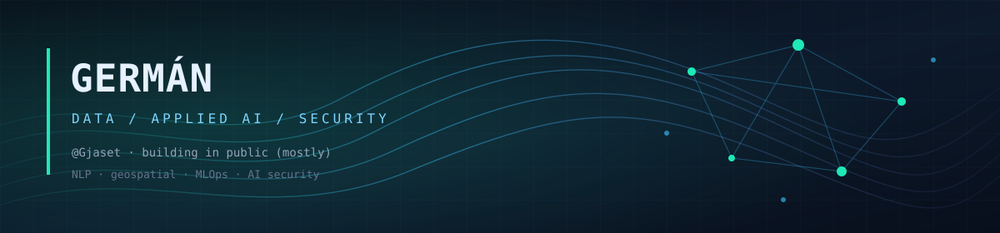

  

<h2 align="center">Hola, soy Germán 👋</h2>

  Data & applied AI engineer. Me muevo entre el <strong>lenguaje</strong>, el <strong>territorio</strong>
  y la <strong>seguridad de los sistemas de IA</strong>.
  Construyo pipelines que se pueden auditar, no solo demos que se ven bien.

  
  
  
  
  

---

## 🧭 Brújula

| Eje | Qué me interesa | Cómo lo abordo |
|---|---|---|
| **Lenguaje** | NLP aplicado, corpus, sentimiento y patrones de diálogo | Limpieza, tokenización y métricas reproducibles |
| **Territorio** | Observación de la Tierra, geodatos y ETL espacial | Pipelines con procedencia y esquemas versionados |
| **IA aplicada** | Modelos clásicos y LLM con trazabilidad | Semillas fijas, experimentos versionados y evidencia |
| **Seguridad** | Robustez, cadena de suministro y privacidad de modelos | Pruebas con fixtures públicos y puertas en CI |

## 🛰️ Proyectos públicos seleccionados

- **[Natural Language Processing applied to the GTA: San Andreas script](https://github.com/Gjaset/Natural-Language-Processing-applied-to-the-GTA-San-Andreas-script)** — minería de texto sobre el guion del juego: tokenización, n-gramas, sentimiento y patrones lingüísticos.
- **[gta-corpus-analyzer](https://github.com/Gjaset/gta-corpus-analyzer)** — análisis de corpus de diálogos con Python.
- **[earth-observation-etl](https://github.com/Gjaset/earth-observation-etl)** — ETL de datos de observación de la Tierra en notebooks reproducibles.
- **[app-eco-region](https://github.com/Gjaset/app-eco-region)** — aplicación Python alrededor de datos ecorregionales.

> También tengo otros experimentos públicos de Jupyter, TypeScript y Excel/IA en el [perfil completo](https://github.com/Gjaset?tab=repositories).

## 🔒 Laboratorio privado (en curso)

Trabajo en un laboratorio privado de **seguridad de IA y conformidad ISO/IEC 42001**: robustez frente a ataques, envenenamiento de modelos, privacidad, cadena de suministro y evidencias de auditoría. Por ahora no publico los repositorios; cuando lo haga, cada métrica saldrá de un script y cada control de la norma llevará su ID verificado.

## 🛠️ Stack que uso

`Python` · `scikit-learn` · `PyTorch` · `Hugging Face` · `Pandas` · `GeoPandas` · `TypeScript` · `Docker` · `GitHub Actions` · `pytest` · `ruff`

## 📫 Contacto

Sin correo público: si quieres hablar de datos, IA o seguridad, ábreme un **issue** en alguno de los repos o menciónname en GitHub.

  Perfil generado con un banner SVG propio · sin trackers ni servicios de estadísticas externas · <a href="https://github.com/Gjaset">@Gjaset</a>

